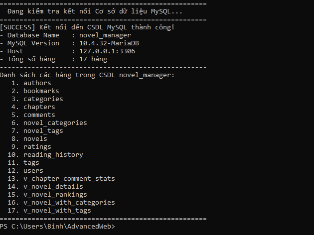
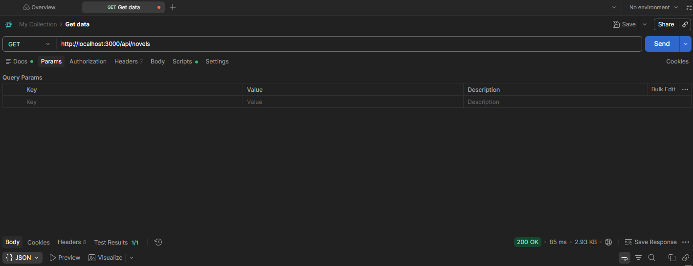

# BÁO CÁO BÀI TẬP NHÓM: XÂY DỰNG PHÁT TRIỂN ỨNG DỤNG WEB NÂNG CAO

## Đề tài: Hệ Thống Quản Lý & Đọc Tiểu Thuyết (Novel Manager)

## Nhóm 7

---

## 1. Repository

- **Repository:** [https://github.com/Nhom7-N01-26/AdvancedWeb](https://github.com/Nhom7-N01-26/AdvancedWeb)

### Thành viên nhóm (Collaborators):

| STT | Họ và tên                           | GitHub Username / Email           | Vai trò & Phân công nhiệm vụ                                                    |
| :-: | :---------------------------------- | :-------------------------------- | :------------------------------------------------------------------------------ |
|  1  | **Lê Thanh Bình** (lebinh17)        | `23010242@st.phenikaa-uni.edu.vn` | Thiết kế CSDL, tạo sql_nhom_7.sql, cấu hình dbconnection.js, CRUD Novels & Categories |
|  2  | **Trần Tiến Đức** (Elysia0533)      | `23010777@st.phenikaa-uni.edu.vn` | Khởi tạo Express, định tuyến API, CRUD Users & Authors |
|  3  | **Nguyễn Tiến Hoàng Vũ** (hoangsfr) | `23010233@st.phenikaa-uni.edu.vn` | 	DevContainer, CRUD Chapters & Tags, tài liệu |
|  4  | **Nguyễn Đức Hiếu** (...) | `23010726@st.phenikaa-uni.edu.vn` | WT Authentication, phân quyền Admin/Author, bảo vệ và kiểm thử API |

---

## 2. Cấu Trúc Repository

```text
AdvancedWeb/
├── screenshots/
│   ├── cau3_database.png
│   ├── cau4_dbconnection.png
│   └── cau5_crud_postman.png
├── My-Node-Project/
│   ├── src/
│   │   ├── controllers/
│   │   │   ├── user.controller.js
│   │   │   ├── novel.controller.js
│   │   │   ├── category.controller.js
│   │   │   ├── author.controller.js
│   │   │   ├── chapter.controller.js
│   │   │   └── tag.controller.js
│   │   ├── routes/
│   │   │   └── api.routes.js
│   │   └── entities/
│   ├── dbconnection.js
│   ├── index.js
│   ├── package.json
│   └── tsconfig.json
├── frontend/
│   ├── src/
│   │   ├── components/
│   │   │   ├── Header.jsx
│   │   │   ├── HeroSearch.jsx
│   │   │   ├── QuickFilters.jsx
│   │   │   ├── CategorySection.jsx
│   │   │   ├── NovelList.jsx
│   │   │   ├── NovelCard.jsx
│   │   │   ├── PlannerTabs.jsx
│   │   │   ├── AuthorSection.jsx
│   │   │   ├── NovelDetailModal.jsx
│   │   │   ├── ReaderModal.jsx
│   │   │   ├── CrudManagerModal.jsx
│   │   │   └── Footer.jsx
│   │   ├── data/
│   │   │   └── initialData.js
│   │   ├── services/
│   │   │   └── api.js
│   │   ├── App.jsx
│   │   ├── index.css
│   │   └── main.jsx
│   ├── package.json
│   └── vite.config.js
├── .env.example
├── .env
├── dbconnection.js
├── package.json
├── sql_nhom_7.sql
└── README.md
```

---

## 3. Nội dung thực hiện

### 3.1. Môi trường phát triển

- Chạy trực tiếp trên môi trường **Node.js cục bộ** (Local Native).
- Sử dụng **Node.js (LTS)** và **MySQL 8.0** (cài đặt trực tiếp hoặc qua XAMPP/Laragon).
- Cơ sở dữ liệu: `novel_manager` từ file `sql_nhom_7.sql`.
- Các cổng dịch vụ: Backend Express (`3000`), NestJS (`3001`), Frontend Vite (`5173`).

### 3.2. Cơ sở dữ liệu

- File `sql_nhom_7.sql` tạo database `novel_manager`.
- Gồm **12 bảng**.
- Có **trigger cập nhật dữ liệu tự động**.
- Có **dữ liệu mẫu** để kiểm tra.

### 3.3. Hệ quản trị CSDL

- Hệ quản trị: **MySQL 8.0**
- Database: `novel_manager`
- Charset: `utf8mb4_unicode_ci`

### 3.4. Kết nối CSDL

File `dbconnection.js` sử dụng:

- `mysql2/promise`
- **Connection Pool**

Thực hiện kiểm tra:

- Phiên bản MySQL.
- Database đang sử dụng.
- Danh sách các bảng.

**Chạy kiểm tra:**

```bash
node dbconnection.js
```

#### Ảnh chụp màn hình 3.4: Kết nối CSDL thành công



_Ghi chú: Ảnh chụp màn hình terminal thực thi `node dbconnection.js` với kết quả `[SUCCESS] Ket noi den CSDL MySQL (novel_manager) thanh cong!`._

---

### Tạo CRUD cho từng đối tượng sinh viên

Triển khai đầy đủ các thao tác CRUD (Create - Read - Update - Delete) bằng chuẩn RESTful API cho các thực thể:

| Thực thể       | Endpoint          |             Method             | Mô tả chức năng                                         |
| :------------- | :---------------- | :----------------------------: | :------------------------------------------------------ |
| **Users**      | `/api/users`      |             `GET`              | Lấy danh sách người dùng (lọc theo role, phân trang)    |
|                | `/api/users/:id`  |             `GET`              | Xem chi tiết người dùng theo ID                         |
|                | `/api/users`      |             `POST`             | Thêm người dùng mới                                     |
|                | `/api/users/:id`  |             `PUT`              | Cập nhật thông tin người dùng                           |
|                | `/api/users/:id`  |            `DELETE`            | Xóa người dùng                                          |
| **Novels**     | `/api/novels`     |             `GET`              | Lấy danh sách tiểu thuyết (tìm kiếm theo tên, thể loại) |
|                | `/api/novels/:id` |             `GET`              | Chi tiết tiểu thuyết kèm chương mới và danh mục         |
|                | `/api/novels`     |             `POST`             | Đăng tải tiểu thuyết mới                                |
|                | `/api/novels/:id` |             `PUT`              | Cập nhật thông tin tiểu thuyết                          |
|                | `/api/novels/:id` |            `DELETE`            | Xóa tiểu thuyết                                         |
| **Categories** | `/api/categories` | `GET`, `POST`, `PUT`, `DELETE` | Quản lý danh mục thể loại                               |
| **Authors**    | `/api/authors`    | `GET`, `POST`, `PUT`, `DELETE` | Quản lý hồ sơ tác giả                                   |
| **Chapters**   | `/api/chapters`   | `GET`, `POST`, `PUT`, `DELETE` | Quản lý nội dung chương truyện                          |
| **Tags**       | `/api/tags`       | `GET`, `POST`, `PUT`, `DELETE` | Quản lý thẻ nhãn                                        |

#### Ảnh chụp màn hình: Kiểm thử CRUD qua Postman



_Ghi chú: Ảnh chụp màn hình giao diện Postman kiểm thử các thao tác CRUD (POST tạo mới, GET danh sách tiểu thuyết với status `200 OK`)._

## 4. NestJS chuyển đổi

Thư mục `novel/` là implementation NestJS độc lập dùng TypeORM và `mysql2`. Express trong `My-Node-Project/` vẫn được giữ nguyên để tương thích ngược; hai ứng dụng dùng cùng database nhưng chạy khác port:

- Express: `3000`
- NestJS: `3001`

NestJS sử dụng `synchronize: false`, vì `sql_nhom_7.sql` là nguồn chuẩn của schema. Entity phản ánh 10 bảng hiện có, bao gồm quan hệ one-to-one, one-to-many, self-reference và many-to-many.

### Kiến trúc NestJS

```text
novel/src/
├── database/database.provider.ts
├── entities/                 # TypeORM entities theo SQL
├── users/ authors/ categories/
├── tags/ novels/ chapters/   # module + provider + service + controller + DTO
└── common/                   # validation/error helpers
```

Luồng xử lý là `Request -> Controller -> Service -> Repository provider -> TypeORM -> MySQL`. Class Diagram nằm tại [novel/docs/class-diagram.md](novel/docs/class-diagram.md), còn danh sách request kiểm thử nằm tại [novel/docs/api-test.md](novel/docs/api-test.md).

### Chạy NestJS

```bash
cd novel
npm install
npm run start:dev
```

API NestJS có prefix `/api`, ví dụ `GET http://localhost:3001/api/novels`. Biến môi trường được mô tả trong [.env.example](.env.example); không commit file `.env` thật.

---

Đây là bản sạch, không emoji, hợp để đưa thẳng vào README:

 README - Hướng Dẫn Cài Đặt & Khởi Chạy

## 5\. Hướng Dẫn Cài Đặt & Khởi Chạy

 ### Backend

 | Thư mục | Công nghệ | Mô tả |
| --- | --- | --- |
| `novel/` | NestJS | Backend chính |
| `My-Node-Project/` | Express | Backend cũ |

### Authentication

 Sử dụng JWT.

 - Đăng ký: `POST /api/auth/register`
- Đăng nhập: `POST /api/auth/login`
- API thay đổi dữ liệu: `Authorization: Bearer <token>`
- `admin`: toàn quyền
- `author`: quản lý novel/chapter của mình

### Hướng dẫn khởi chạy Local

Dự án chạy trực tiếp trên máy cục bộ mà không cần Docker:

**1. Khởi động Backend (Express)**

```bash
cd My-Node-Project
npm install
node dbconnection.js
npm start
```

**2. Khởi động Backend (NestJS)**

```bash
cd novel
npm install
npm run start:dev
```

**3. Khởi động Front-end Booking.com (React-Bootstrap)**

- **Chạy trực tiếp từ thư mục gốc:**
  ```bash
  npm run frontend
  ```
- **Hoặc chạy từ thư mục `frontend/`:**
  ```bash
  cd frontend
  npm install
  npm run dev
  ```
- **Mở trình duyệt truy cập:** [http://localhost:5173/](http://localhost:5173/)

### API & URL Reference

| Chức năng | URL |
| --- | --- |
| Trang chủ Express | `http://localhost:3000/` |
| Health Check | `http://localhost:3000/health` |
| Danh sách Novel | `http://localhost:3000/api/novels` |
| Danh sách User | `http://localhost:3000/api/users` |
| NestJS API | `http://localhost:3001/api/novels` |
| Front-end Booking | `http://localhost:5173/` |

---

## 6. Giao Diện Front-end Theo Chuẩn Bố Cục Booking.com (React-Bootstrap)

Nhóm đã hoàn thành toàn diện giao diện Front-end cho đề tài **Hệ Thống Quản Lý & Đọc Tiểu Thuyết (Novel Manager)** tuân thủ chính xác bố cục đặc trưng của [Booking.com](https://www.booking.com/) và sử dụng thư viện **React-Bootstrap**:

1. **Header & Thanh điều hướng:**
   - Gam màu xanh Navy đặc trưng của Booking (`#003580`), thương hiệu `NovelBooking.vn` với logo `.vn` nổi bật.
   - Thanh tiện ích: Ngôn ngữ (🇻🇳 Tiếng Việt), Bộ chuyển đổi vai trò Demo (Admin, Tác giả, Độc giả).
   - Nút tắt *"Đăng truyện mới"* và *"Quản lý tác phẩm"* truy cập trực tiếp.
   - Thanh Tabs điều hướng: *Tất cả tiểu thuyết*, *Thể loại truyện*, *Bảng xếp hạng Hot*, *Tác giả nổi tiếng*, *Tủ sách của tôi*, *Quản lý tác phẩm*.
2. **Hero Banner & Thanh tìm kiếm màu vàng (Signature Floating Search Bar):**
   - Tiêu đề chào đón chuẩn Booking: *"Tìm kiếm tiểu thuyết tiếp theo của bạn"*.
   - Khung tìm kiếm màu vàng viền đặc trưng (`#febb02`) gồm 4 khối liền kề:
     - 🔍 Nhập từ khóa (Tên truyện, nhân vật, tác giả...).
     - 🏷️ Chọn thể loại (Tiên Hiệp, Kiếm Hiệp, Đô Thị, Huyền Huyễn, Võng Du...).
     - 📊 Chọn tình trạng (Tất cả, Đã hoàn thành Full, Đang ra chương...).
     - 🔘 Nút *"Tìm kiếm"* xanh lam Booking (`#006ce4`).
3. **Genius Reader Banner & Thanh tiếp tục đọc:**
   - Phù hiệu độc giả thân thiết *Genius Reader* (giảm 10-20% chương VIP).
   - Thanh tiến độ đọc truyện dở dang với nút *"Đọc tiếp"* một chạm.
4. **Khám phá theo thể loại truyện (Browse by Property Type):**
   - Lưới thẻ thể loại với ảnh bìa, số lượng tác phẩm trong CSDL (`sql_nhom_7.sql`) và tính năng lọc tức thì khi bấm chọn.
5. **Danh sách thẻ tiểu thuyết & Bộ lọc bên trái (Property Cards & Filter Sidebar):**
   - **Thanh lọc bên trái:** Lọc theo Thể loại, Tình trạng (Full / Ongoing), Điểm đánh giá (9.5+ Xuất sắc, 9.0+ Rất tốt), Đề cử.
   - **Thẻ tiểu thuyết Booking:** Ảnh bìa tỉ lệ 3:4, phù hiệu Genius/Full/Hot, nút thả tim lưu tủ sách, điểm số Booking (`9.9 / 10 Kiệt tác xuất sắc` trong ô xanh navy), thông tin tác giả đã xác minh, chương mới nhất, nút *"Đọc ngay"* và *"Xem chi tiết"*.
6. **Lên kế hoạch đọc truyện (Quick Reading Planner):**
   - Bộ Tab chọn tâm trạng đọc: *Tu Tiên Cày Cấp*, *Nhiệt Huyết Giang Hồ*, *Đô Thị Thần Y*, *eSports & Võng Du*.
7. **Tác giả nổi tiếng (Author Spotlight):**
   - Hồ sơ tác giả chuẩn từ database (Mặc Hương Đồng Xứ, Thiên Tàm Thổ Đậu, Vong Ngữ, Hồ Điệp Lam) kèm lượt đọc, số tác phẩm, đánh giá và nút xem toàn bộ tác phẩm.
8. **Cửa sổ đọc truyện tương tác (Chapter Reader Modal):**
   - Giao diện đọc toàn màn hình với nội dung chương trích từ `sql_nhom_7.sql`.
   - Điều khiển phong phú: Chuyển chương nhanh, tăng giảm cỡ chữ (`A-` / `A+`), đổi 3 chế độ nền (*Sáng*, *Giấy cổ - Sepia*, *Ban đêm - Dark*).
9. **Bảng điều khiển Quản Lý Tác Phẩm (CRUD Management Panel):**
   - Đầy đủ 4 thao tác CRUD theo đúng yêu cầu đề tài: Thêm truyện mới, Xem chi tiết, Sửa thông tin truyện, Xóa truyện, Thêm chương mới.
   - Cơ chế tự động đồng bộ API RESTful `:3000` và dự phòng LocalStorage thông minh, đảm bảo giao diện luôn hoạt động ổn định 100%.
10. **Chân trang đa cột (Multi-column Footer):**
    - Hộp đăng ký nhận thông báo chương mới (Newsletter).
    - Các liên kết thể loại, tác giả, điều khoản và bảng thông tin thành viên **Nhóm 7**.
